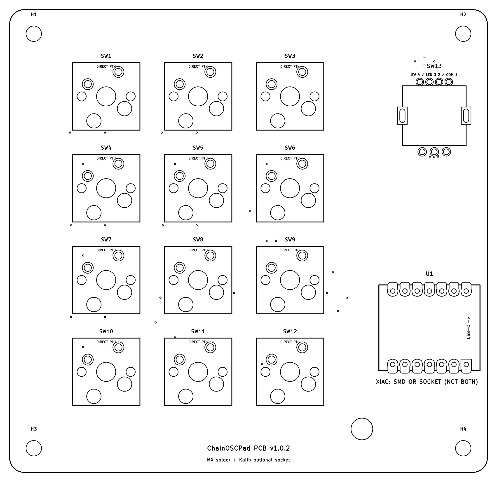
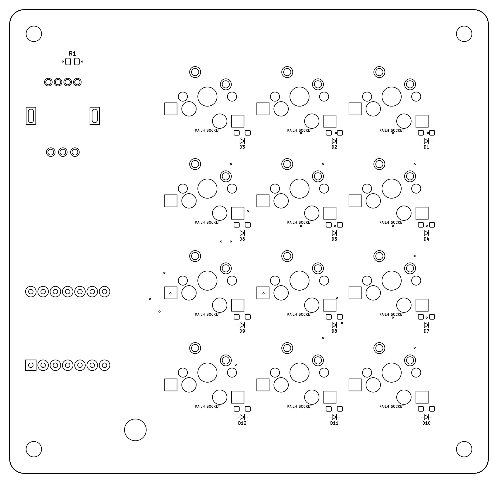
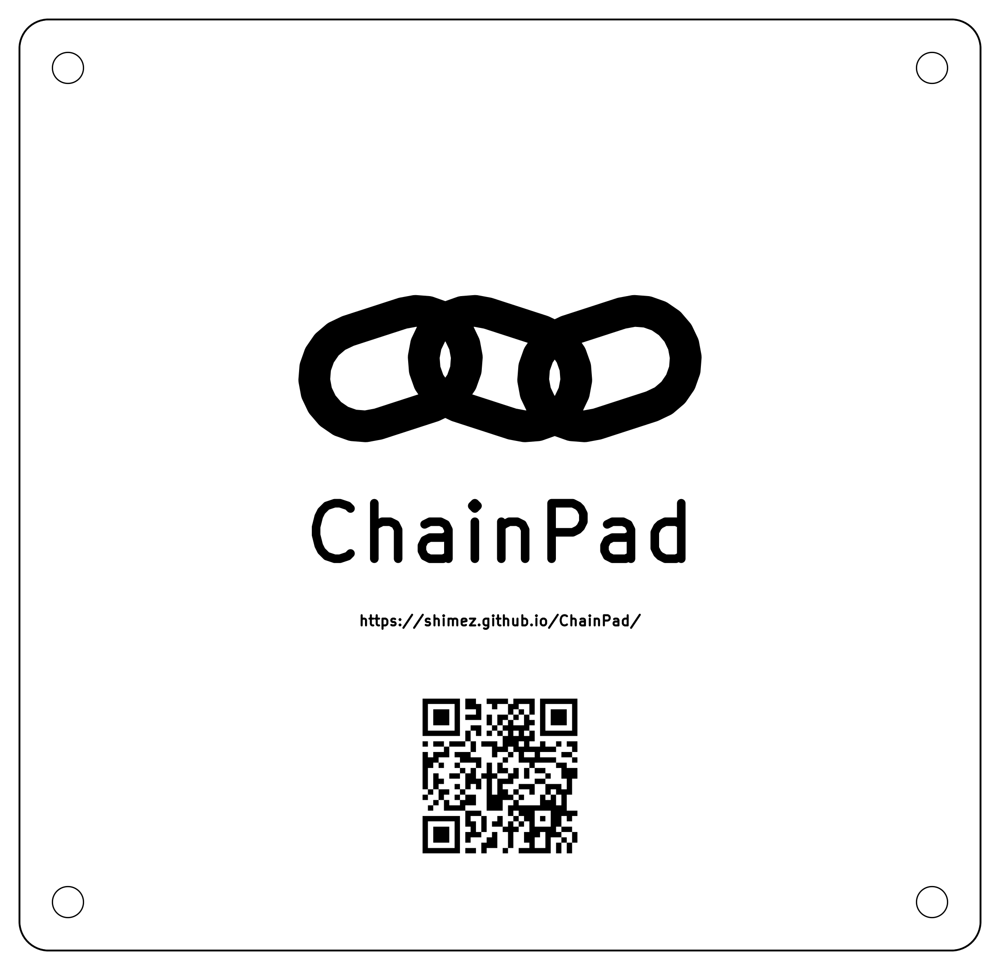
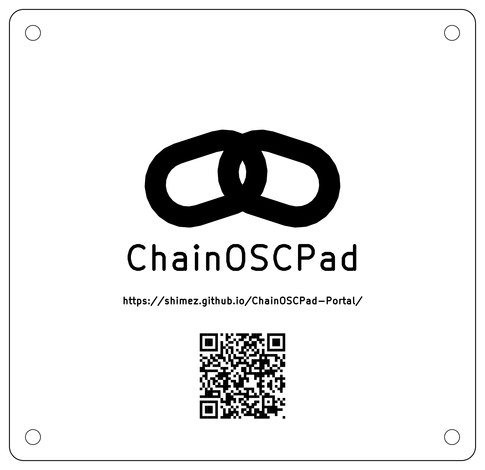
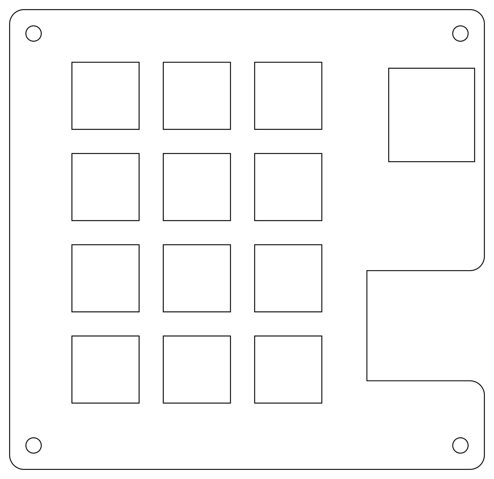
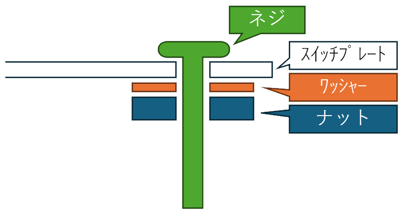
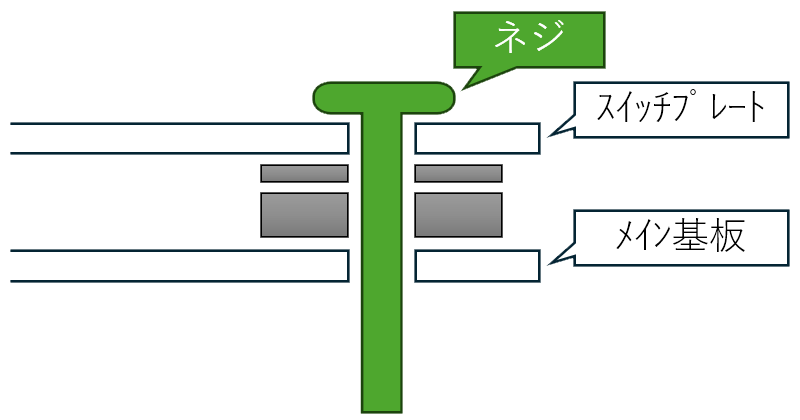
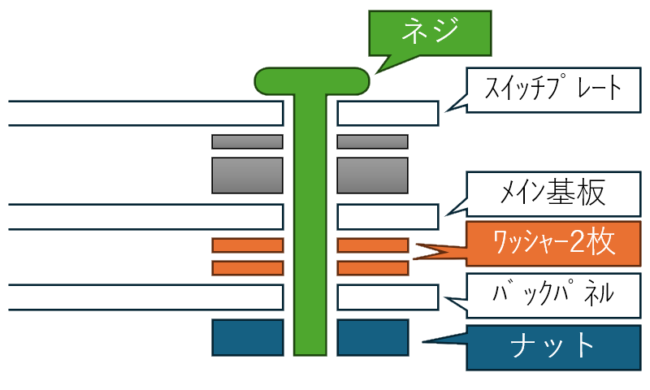

# ChainPad 組み立てガイド

<!-- 本文をここに記載してください。執筆・公開方法は docs/assembly-guide-authoring.md を参照。 -->

基板・エンコーダー・ネジ類を含む自作キットの組み立てガイドです。
XIAOやキースイッチなどを別途用意し、はんだ付けして組み立てる方向けの内容です。

準備中です。

## 1. キットの内容について

### 1-1. キットの内容物

| 品名                     | 個数 |
| ------------------------ | ---- |
| メイン基板               | 1    |
| バックパネル             | 1    |
| スイッチプレート         | 1    |
| ロータリーエンコーダー   | 1    |
| ネジ（M3 12mm）          | 4    |
| ナット（M3）             | 8    |
| ワッシャー（M3 厚さ1mm） | 12   |

内容物の外観

(1)メイン基板

<table>
    <tr>
        <td>表</td>
        <td>裏</td>
    </tr>
    <tr>
        <td></td>
        <td></td>
    </tr>
</table>

(2)バックパネル

<table>
    <tr>
        <td>表</td>
        <td>裏</td>
    </tr>
    <tr>
        <td></td>
        <td></td>
    </tr>
</table>

(3)スイッチプレート

<table>
    <tr><td>
</td></tr>
</table>

**キット以外に必要なもの**

| 品名                                                     | 個数 |
| -------------------------------------------------------- | ---- |
| XIAO（ESP32S3/C5/C6のいずれか）                          | 1    |
| キースイッチ（MX互換）                                   | 12   |
| Kailhスイッチソケット（キースイッチ交換に対応する場合）  | 12   |
| XIAO取り付け用ソケット（直接はんだ付け方式の場合は推奨） | 1組  |

## 2. 組み立て手順の違いについて

「スイッチソケットを利用する場合」と「キースイッチを直接はんだ付けする場合」とで、組み立て手順が異なります。

- キースイッチを直接はんだ付けする場合、XIAOはソケットで取り付けることを強く推奨します（SMD実装した場合、はんだ付け不良時のリカバリ時にスイッチプレートが干渉して作業が困難となります）
- キースイッチを直接はんだ付けする場合、キースイッチのはんだ付けの前にスイッチプレートを基板に取り付ける必要があります。

## 3. 組み立て手順① スイッチソケット利用（推奨手順）

### 3-1. スイッチソケットのはんだ付け

メイン基板の裏面に、スイッチソケットをはんだ付けしてください（計12個）

### 3-2. XIAOのはんだ付け

SMD実装する場合：メイン基板の表面にXIAOを乗せ、側面をはんだ付けしてください
ソケット実装する場合：メイン基板の表面からXIAOのソケットを挿入し、裏面ではんだ付けしてください

### 3-3. ロータリーエンコーダーのはんだ付け

メイン基板の表面からロータリーエンコーダーを挿入し、裏面ではんだ付けしてください。

### 3-4. スイッチプレートの取り付け

1. スイッチプレートの表面からねじを挿入し、裏面からワッシャーとナットを取り付けてください

2. 手順1で組み合わせたスイッチプレートのネジをメイン基板に挿入してください

断面図のグレー表示は取り付け済みのパーツです

### 3-5. バックパネルの取り付け

1. メイン基板から出たネジ部分にワッシャーを2つずつ取り付けてください
2. バックパネルを取り付け、ナットで締め付けてください

### 3-6. キースイッチの取り付け

キースイッチをソケットに挿入してください。（端子の折れ曲がりに注意してください）

## 4. 組み立て手順② キースイッチ直接はんだ付け

### 4-1. XIAO取り付け用ソケットのはんだ付け

メイン基板の表面からXIAOのソケットを挿入し、裏面ではんだ付けしてください

### 4-2. ロータリーエンコーダーのはんだ付け

メイン基板の表面からロータリーエンコーダーを挿入し、裏面ではんだ付けしてください。

### 4-3. スイッチプレートの取り付け

1. スイッチプレートの表面からねじを挿入し、裏面からワッシャーとナットを取り付けてください

2. 手順1で組み合わせたスイッチプレートのネジをメイン基板に挿入してください

断面図のグレー表示は取り付け済みのパーツです

### 4-4. キースイッチのはんだ付け

キースイッチを挿入し、メイン基板の裏面からはんだ付けしてください（計12個）

### 4-5. バックパネルの取り付け

1. メイン基板から出たネジ部分にワッシャーを2つずつ取り付けてください
2. バックパネルを取り付け、ナットで締め付けてください

## 5. 組み立て後の作業について

組み立て後はXIAOにファームウェアを書き込むと完成です。
[Getting Startedの 8. ファームウェアを書き換える](../getting-started/#8)の手順を実施後、Getting Startedの『1. 基本情報』から順に確認してください。
