# ChainPadマニュアル

<!-- 本文をここに記載してください。執筆・公開方法は docs/manual-authoring.md を参照。 -->

[TOC]

## 1. はじめに

### 1-1. ChainPadの外観

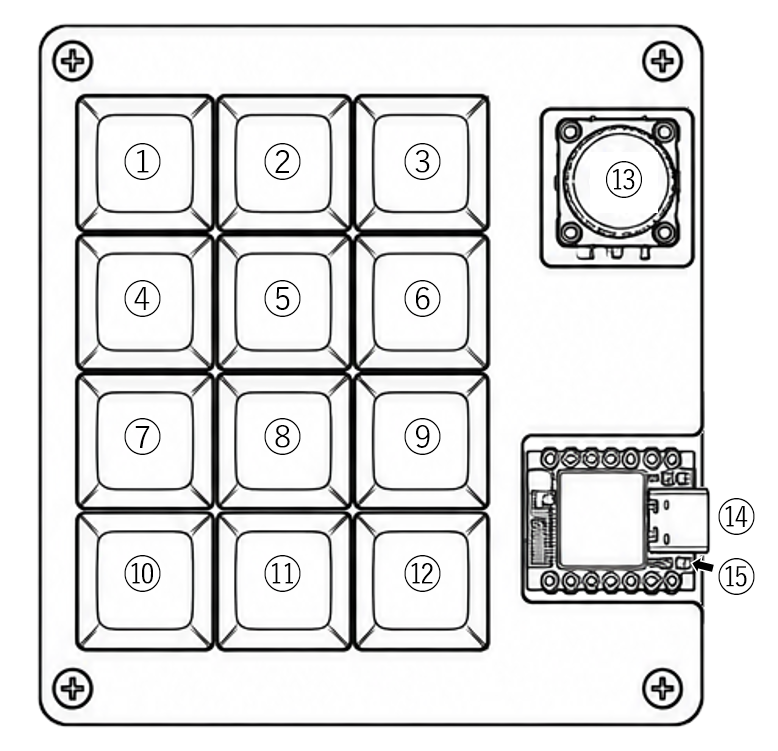

①～⑫：キー / ⑬：エンコーダー / ⑭：USB Type-Cポート / ⑮：BOOTボタン

### 1-2. Getting Startedについて

ChainPadを入手してから最初に行う手順については[Getting Started](../getting-started/)を参照してください

## 2. 基本概念

### 2-1. Key

KeyはChainPadの物理キーを表します。 
ChainPadの基本ハードウェアには12のキーが搭載されており、各キーに対して押した時・離した時に実行される操作を設定できます。 

### 2-2. ロータリーエンコーダー

ChainPadには、回転操作と押し込み操作ができるロータリーエンコーダーが搭載されています。 
押し込み操作（Encoder Push）にはKeyと同様に押した時・離した時に実行される操作を設定可能です。
回転操作には次の2つのモードがあります

- Rotation Direction（回転方向モード）：エンコーダーを時計回り・反時計回りに回転させた際、それぞれに設定したAction Chainを実行するモードです。

- Rotation Value（回転量モード）：エンコーダーの回転量に応じて複数のOSC/MIDI CCの値を変化させ、送信するモードです。

### 2-3. Action（アクション）

Actionは、ChainPadが実行する個々の動作です。 
例えば「VRChatに対してOSCメッセージを送信する」「MIDIのノートを送信する」「キーボードのキー入力を送信する」といった動作がActionに当たります。 
また、「指定した時間だけ次の処理を待つ」という動作もActionの一種として設定可能です。 
Actionには種類ごとに設定項目があり、送信する値などを指定できます。

### 2-4. Action Chain（アクションチェーン）

Action Chainは、複数のActionを組み合わせ、順番に実行する仕組みです。 
一つのキー操作から複数のOSCメッセージを送信したり、OSC・MIDI・HIDなど異なる種類のActionを組み合わせたりすることが可能です。 
また、WaitをAction Chainの途中に挿入することでActionの実行タイミングを調整できます。 
例えば次のような動作を一回のキー操作で実行できます。

1.  OSCメッセージを送信してアバターのパーティクルをONにする
2.  5000ミリ秒待機（Wait）
3.  OSCメッセージを送信してアバターのパーティクルをOFFにする

異なる種類のActionを組み合わせて、一回のキー操作にすることも可能です。

1.  OSCメッセージを送信してカメラをストリームモードにする
2.  OSCメッセージを送信してカメラのSpoutモードをONにする
3.  OSCメッセージを送信してカメラのスムージングをONにする
4.  3000ミリ秒待機（Wait）
5.  HIDでF13キーを押して、OBSのシーンを切り替える（蓋絵解除）※

※ OBSの操作を行うにはOBS側でホットキーの設定が必要です

このように、Action Chainを使うことで複数の操作や時間差のある動作をまとめて実行できます。

### 2-5. Preset（プリセット）

PresetはChainPadの操作設定をまとめたデータです。 
キーやロータリーエンコーダーに割り当てたAction Chainなどの設定をひとまとまりのファイルとして扱います。 
一つのキーに設定したAction Chainを保存するキープリセットと、装置全体の設定（Wi-Fi設定を除く）を保存するデバイスプリセットが存在します。 
Presetを利用することで、設定のバックアップや復元、共有が可能となります。

## 3. 設定画面（Configurator）

### 3-1. 画面構成

ChainPadの設定画面は主に8つのエリアに分かれています。

- 配列・テーマ設定エリア
- 本体情報表示エリア
- OSC送信先設定エリア
- 入力選択エリア
- 入力設定エリア
- 保存ボタンエリア
- 設定Import/Exportエリア
- メンテナンスエリア

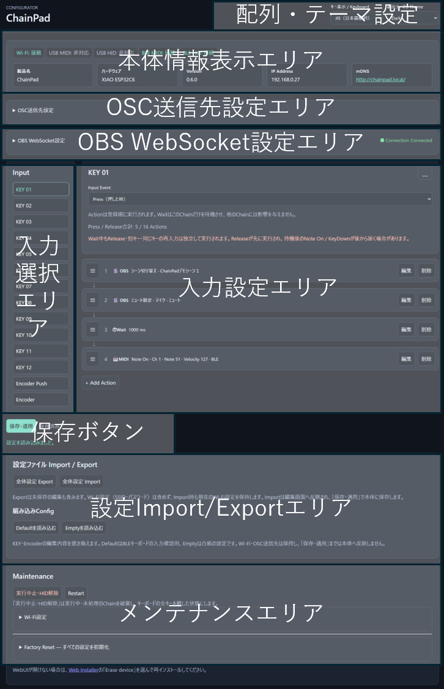

### 3-2. 配列・テーマ設定

画面右上には、キー表示と表示テーマを設定する欄があります。

- キー表示：HID設定時のキー表示に影響します。使用しているPCのキー配列に合わせて選択してください
- 表示テーマ：Dark（ダークテーマ）とLight（ライトテーマ）が選択可能です。使いやすいテーマを選択してください

### 3-3. 本体情報表示エリア

本体情報表示エリアには、ChainPadの接続状態、ChainPadの本体情報が表示されます。
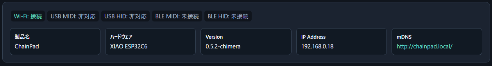

### 3-4. OSC送信先設定

OSC送信先設定エリアでは、OSCの送信先に関する情報を設定します。
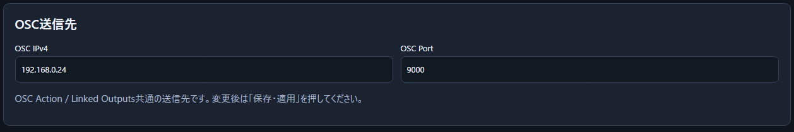

- OSC IPv4欄にはVRChatなどのアプリを実行しているPCのIPアドレスを入力してください。
- OSC PortはVRChatでの利用時は変更する必要はありません。

### 3-5. 入力選択エリア

入力選択エリアでは設定を行うキー・エンコーダーを選択します。
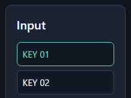

### 3-6. 入力設定エリア

入力設定エリアでは、入力選択エリアで選んだキー・エンコーダーを操作したときの動作を設定します。

> **重要： 編集した設定は「保存・適用」ボタンを押すまで有効になりません。**

#### 3-6-1. キー（KEY）の場合

キーの場合、キーを押した時と離した時の動作を設定可能です。
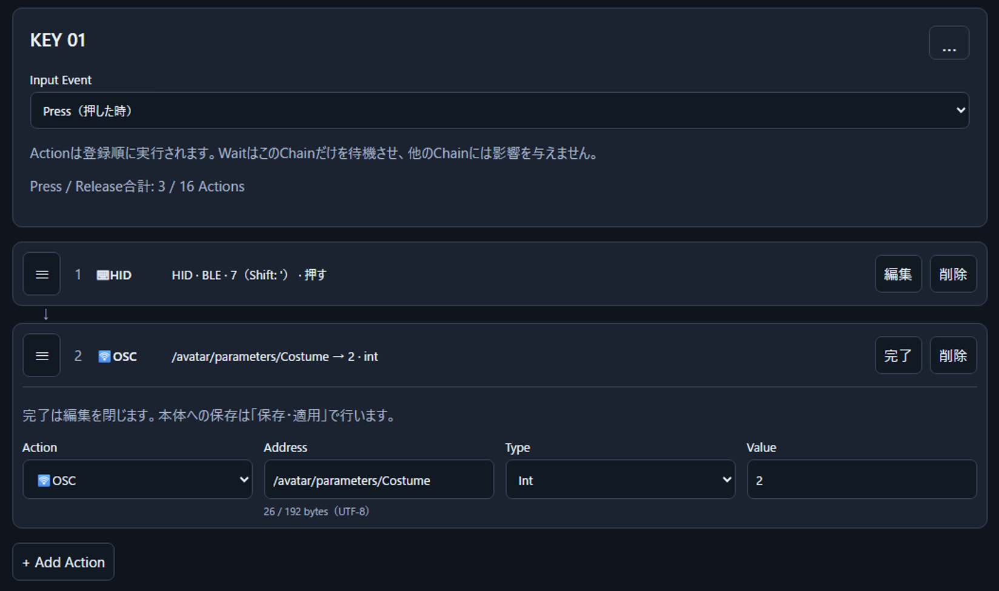

- 右上の「…」メニューから、キー単位のプリセットのエクスポート／インポートが可能です。
- Input Eventの「Press（押した時）」「Release（離した時）」を選択することでActionの実行タイミングを切り替え可能です。
- 入力設定エリアの一番下にある「+ Add Action」をクリックすることでActionが追加されます。Actionは押した時と離した時の合計で16個まで追加可能です。
- 各Actionの左端にある「≡」をドラッグ＆ドロップすることで、Actionの実行順を並べ替えることができます。

#### 3-6-2. エンコーダープッシュ（Encoder Push）の場合

エンコーダープッシュの設定はキーと同様です。
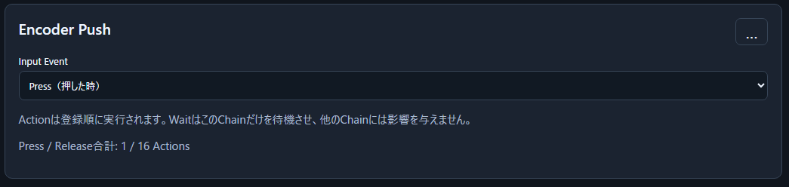

#### 3-6-3. エンコーダー（Encoder）の場合

エンコーダーの設定は、Encoder Modeによって大きく変わります。

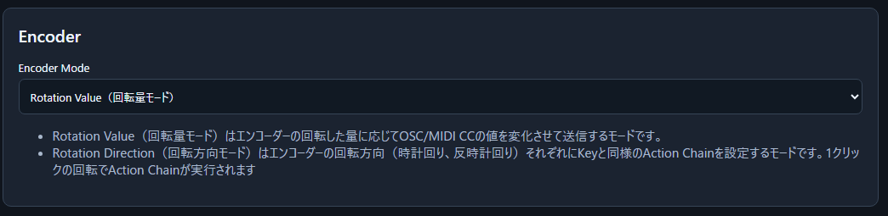

Encoder Modeでは、「Rotation Direction（回転方向モード）」と「Rotation Value（回転量モード）」を選択します。

##### Rotation Direction（回転方向モード）

回転方向モードはエンコーダーの回転方向（時計回り・反時計回り）に応じて、設定したAction Chainが実行されます。 

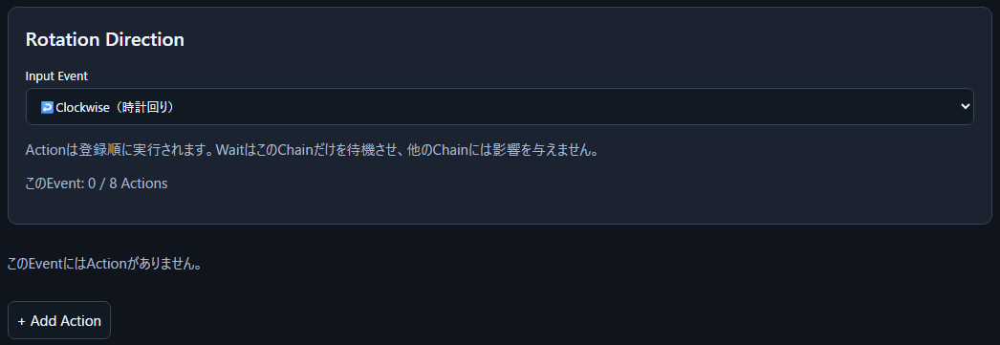

時計回り・反時計回りにそれぞれ8件のActionが登録可能です。
基本的な操作はKEYと共通です。

##### Rotation Value（回転量モード）

回転量モードはエンコーダーの回転量に応じて、複数のOSC/MIDI CCの値を同時に操作するモードです。 
エンコーダの回転に合わせてアバターのパラメータとワールド演出を同期させて操作するといったことが可能です。

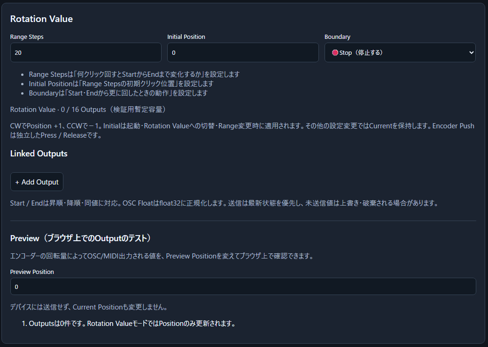

Linked Outputs欄で、出力するOSC/MIDI CCの設定を行います。 
「+ Add Output」を押すことで、出力を追加できます。
プロトコルの種類、Start、Endに送信される値の開始値、終了値などを設定してください。

Preview（ブラウザ上でのOutputのテスト）欄ではOSC/MIDI出力される値をブラウザ上で確認することができます。 
Preview Positionにエンコーダーのポジション（何クリック分回したか）を入力すると、OSC/MIDI CCで送信される値を実際に送信せず確認することが可能です。 

### 3-7. 保存ボタン

- 「保存・適用」ボタンを押すことで、編集・読み込みした設定をChainPad本体に保存します。
- 設定の保存状況に応じて、ボタン周辺のメッセージが変化します。

### 3-8. 設定Import/Exportエリア

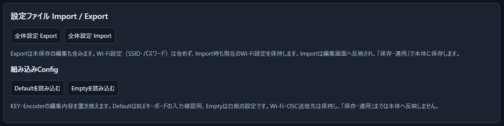

- 「全体設定Export」を押すことでWi-Fi設定を除くChainPadの設定を外部ファイルに保存します。
- 「全体設定Import」を押すことでExportした設定ファイルを読み込みます。
- 「Defaultを読み込む」はChainPad購入時の初期設定（テンキー風設定）を読み込みます。
- 「Emptyを読み込む」はすべてのキー・エンコーダーの設定がされていない状態の設定を読み込みます。

> **重要： Importした設定は「保存・適用」ボタンを押すまで有効になりません。**

### 3-9. メンテナンスエリア

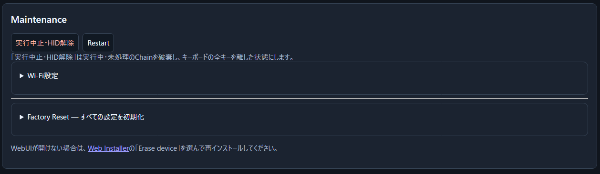

- 「実行中止・HID解除」ボタンは実行中・未処理のAction Chainを全て破棄し、キーボードの全キーを離した状態にします。
- 「Restart」ボタンを押すとChainPadが再起動します。
- 「Wi-Fi設定」では接続するWi-Fiを変更可能です。
- 「すべての設定を初期化…」ボタンを押すと、Wi-Fi設定、OSC設定、Bluetoothのペアリング情報を削除し、初期設定（テンキー風設定）の状態に戻して再起動します。

## 4. Actionの設定

### 4-1. OSC

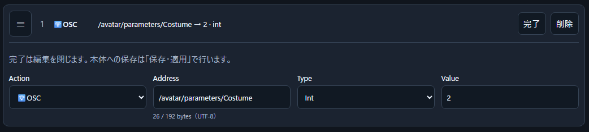

- Address欄には、送信するOSC Addressを指定します。VRChatで指定できるOSCアドレスに関しては<https://wiki.vrchat.com/wiki/OSC>を参照してください。
- Typeでは、値の型を指定します。
- Value欄には送信する値を入力します。

### 4-2. MIDI

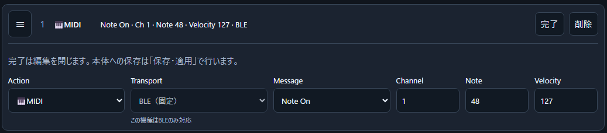

- Message欄で送信するMIDIメッセージを指定します。
- Message欄で選択できる「All Notes」は、「ChainPadに設定されている有効なMIDI Note全てを操作」することが可能です。例えばワールドの演出を全てON/OFFするなどの操作、意図せず特定のNoteがONになった時の強制OFFなどに活用可能です。

### 4-3. HID

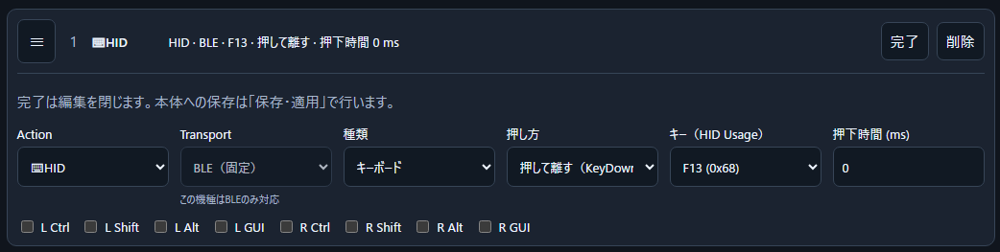

- 種類欄で送信するメッセージの種類を選択します。
- 下部にある「L Ctrl」などのチェックボックスで修飾キーの設定が可能です

### 4-4. Wait

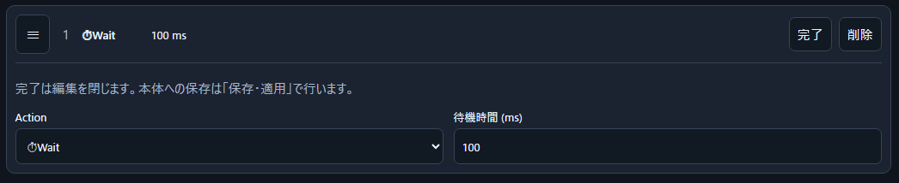

- 待機時間欄に値を記入することで、次のActionの実行まで指定時間（何ミリ秒）待機させることが可能です。
- Waitによる待機は該当のAction Chainにのみ有効です。別キーの操作、同じキーの別操作（押すに対する離すなど）、同じキーの再操作のAction Chainは独立して実行されます。

## 5. 接続・通信設定

### 5-1. Wi-Fi

ChainPadでは、以下の目的でWi-Fiを使用します

- ChainPadの設定
- OSC送信（Wi-Fiを利用したVRChatなどの操作）

ChainPadの設定画面には認証機能がありません。公衆Wi-Fiのような不特定多数が利用する環境での使用は非推奨です。

### 5-2. Bluetooth

ChainPadでは、以下の目的でBluetoothを使用します

- BLE-MIDI（Bluetoothを利用したMIDI操作）
- BLE-HID（Bluetoothを利用したキーボード操作）

Windowsでは、BLE-MIDI機能を利用するためにはペアリング前にBLE-MIDIドライバーのインストールが必要な場合があります。 
開発時の検証ではKORG社のBLE-MIDIドライバーでの動作を確認しました。 
BLE-MIDIドライバの導入、初回ペアリング手順については[Getting Started](../getting-started/)を参照してください

### 5-3. USB

ChainPadでは、以下の目的でUSBを使用します。

- ChainPadへの電源供給
- ファームウェアの書き込み
- （XIAO ESP32S3使用時のみ）USB-MIDI／USB-HID

## 6. ファームウェア管理

ChainPadのアップデートがあった場合、[Web Installer](../installer/)にてファームウェアの更新が可能です。 
また、ChainPadと共通の基板を利用する[ChainOSCPadシリーズ](https://shimez.github.io/ChainOSCPad-Portal/)のファームウェアへの書き換えも可能です。 
Web Installerを利用する際はEdge/Chromeを使用することを推奨します。 
**ファームウェアの書き換えを行う際は、事前に全体設定のExportを行うことを推奨します。**

1. Web Installerのページにアクセスし、「Connect」や「Install」のボタンを押す
2. シリアルポートの一覧が表示されるため、「USB JTAG/serial debug unit」と書かれたポートを選択する ※1 ※2
3. 画面の指示に従い、ファームウェアを書き込む
4. ファームウェア書き換え後はBluetooth接続が不安定になる場合があります。PCのBluetooth設定で『ChainPad』（旧名『ChainPad Chimera』）を一旦削除し、改めて接続しなおしてください。

※1 「USB JTAG/serial debug unit」と書かれたシリアルポートが複数ある場合、ChainPadを抜き差しし、抜いている間表示が消えたポートを選択してください。 
※2 「USB JTAG/serial debug unit」と書かれたシリアルポートがない場合や、書き込みに失敗した場合は、XIAOのBOOTボタンを押しながらUSBケーブルを接続してください。
